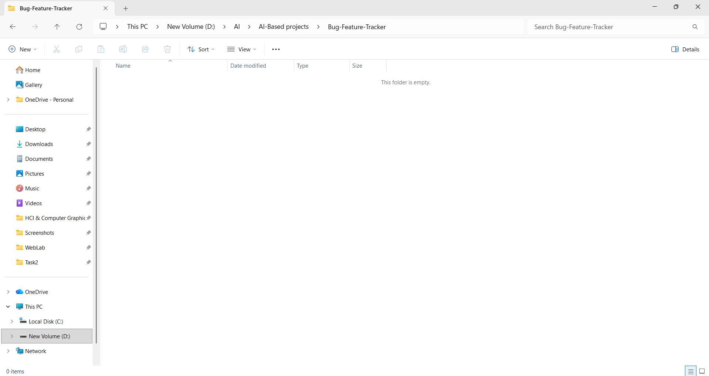
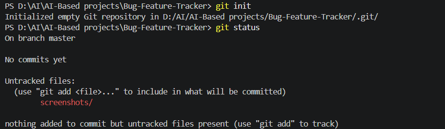
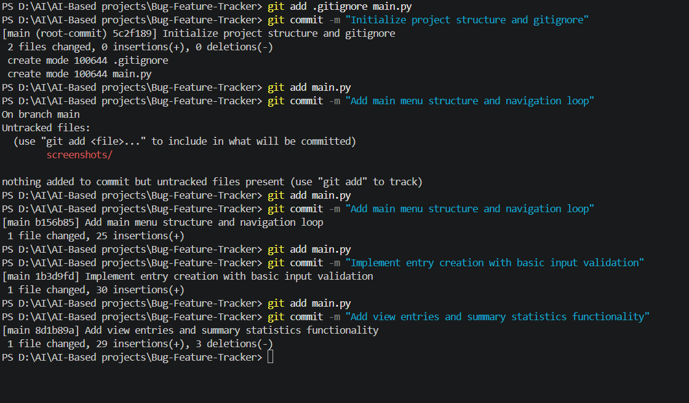
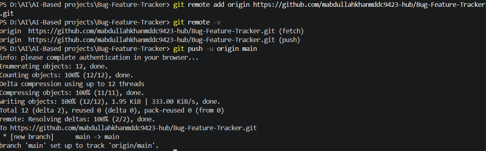
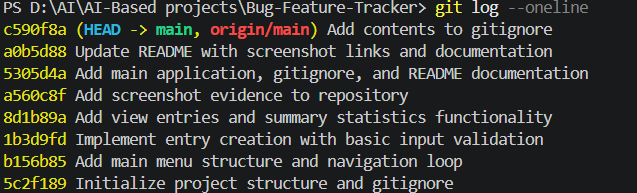

# Bug & Feature Tracker

### IEEE LGU Student Branch AI/ML Cohort One - Fall 2026

**Week 4 Assignment:** Practical Tasks with Git CLI & Python
**AI/ML Leads:** Abdullah Faisal & Alina Irshad

## Project Description

A lightweight Python terminal application designed to record software issues and feature requests, view saved entries, and view overall project tracking statistics.

## Features

- **Add Entry**: Input bug or feature details including title, type, priority, and status.
- **View All Entries**: Displays all logged issues in a readable format.
- **Display Summary Statistics**: Summary showing total entries, bugs, features, open, and resolved items.
- **Menu Navigation**: Simple menu-driven console user interface.
- **Input Validation**: Prevents empty titles and handles invalid selection choices gracefully.

## Technologies Used

- Python 3
- Git CLI
- GitHub

## How to Run

Run the application using Python 3:
python main.py

## 5. Git Workflow

The repository was initialized locally using git init. Development progressed through a series of structured, meaningful commits via the Git CLI. Finally, the local repository was connected to an empty GitHub repository and uploaded using git push -u origin main.

## 6. Development History

Initialized project and implemented entry creation menu.
Added functionality to view all recorded entries.
Implemented summary statistics feature.
Added input validation for entry creation and menu choices.
Added .gitignore and project README documentation.

## Screenshots

### Initial Empty Folder

#### Description

Shows the initial local project directory Bug-Feature-Tracker before adding any code files or initializing Git.

### Git Initialization

#### Description

Terminal output demonstrating local repository initialization using git init and checking the initial state with git status.

### Commits

#### Description:

Terminal output showing iterative staging (git add) and committing (git commit) of feature implementation changes.

### Successful Push

#### Description

Terminal output displaying the successful push of local commits to the remote GitHub main branch.

### Commit History

#### Description

Terminal output from git log --oneline verifying a complete history of meaningful commits tracking project development.
